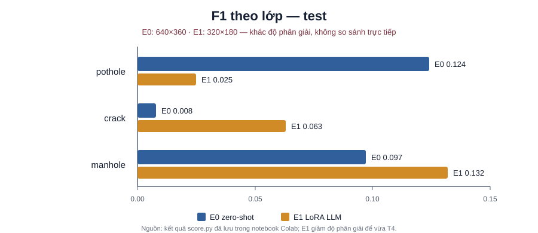

# Báo cáo Lab Day 10 — Qwen3-VL road damage

Họ tên: Nguyễn Văn Chiến (2A202602926)

`dataset_version`: `d10-21e4070301`

> Cập nhật theo kết quả đã thực sự chạy trên Colab T4. E0 dùng kích thước ảnh mặc định 640×360; lần chạy E1 hiện có dùng 320×180 để tiết kiệm VRAM/thời gian nên **hai số chưa phải phép so sánh công bằng**. E2/E3/E4 chưa có kết quả hợp lệ; không suy diễn số liệu còn thiếu.

## Bảng tổng hợp

| Mã | Setup | Tham số huấn luyện | VRAM đỉnh (GB) | Phút | F1 | CI95 | FP/ảnh | F1 pothole | F1 crack | F1 manhole |
|---|---|---:|---:|---:|---:|---|---:|---:|---:|---:|
| E0 | Zero-shot, ảnh 640×360 | 0 | chưa đo | chưa đo | 0.051 | 0.029–0.078 | 0.80 | 0.124 | 0.008 | 0.097 |
| E1 | LoRA LLM r=16, ảnh 320×180 | 33,030,144 | 9.076 | 26.49 | 0.071 | 0.052–0.094 | 1.77 | 0.025 | 0.063 | 0.132 |
| E2 | E1 + projector | chưa chạy hợp lệ | — | — | — | — | — | — | — | — |
| E3 | E2 + LoRA ViT | chưa chạy | — | — | — | — | — | — | — | — |
| E4 | Chưa chạy | — | — | — | — | — | — | — | — | — |

E0 có `parse_valid_rate` 0.653; E1 là 0.971. E1 loss cuối trung bình 100 lần cập nhật là 0.6051. Checkpoint E1 đã được đồng bộ lên Google Drive. E1 F1 chỉ cao hơn E0 0.020 trong khi thay đổi cả độ phân giải, vì vậy chưa thể kết luận LoRA cải thiện chất lượng.

## 10 câu hỏi

### Câu 1 — Kiến trúc và khối được cập nhật

Theo GUIDE, Qwen3-VL-4B có khoảng 4.0B tham số LLM, 415M ViT; projector gồm `visual.merger` và `visual.deepstack_merger_list`, dự kiến khoảng 109M. E1 cập nhật LoRA trên 252 module LLM, E2 mở thêm projector, E3 thêm LoRA trên các block ViT (tổng mục tiêu LoRA 348 module). E1 thực tế có 33,030,144 tham số huấn luyện. Trong lần kiểm tra E2, model thực tế chỉ tìm thấy 54,579,200 tham số projector phù hợp tên; chênh lệch với con số tham khảo chưa được giải thích và E2 chưa được tính là hoàn tất.

### Câu 2 — E0

E0 có `parse_valid_rate = 0.653`. Trên test, precision 0.081, recall 0.038, F1 0.051; theo lớp: pothole F1 0.124, crack 0.008, manhole 0.097. Hai điểm yếu nhìn thấy qua số liệu là nhiều output không parse được (34.7%) và khả năng phát hiện thấp (recall 0.038). Notebook chưa lưu ví dụ raw output đại diện nên chưa trích dẫn một chuỗi cụ thể.

### Câu 3 — Thang tọa độ

Chưa chạy thí nghiệm đối chứng chấm cùng dự đoán theo pixel và theo thang 0–1000. Vì vậy hiện chưa có F1 để báo cáo. Các nhãn huấn luyện được chuyển từ YOLO chuẩn hoá sang số nguyên 0–1000; E4 cần bổ sung phép kiểm tra sai thang có kiểm soát.

### Câu 4 — Mask loss

Mask phần prompt bằng `-100` để loss chỉ tối ưu câu trả lời JSON. Nếu tính loss cả prompt, phần lớn mục tiêu sẽ là học lại prompt cố định và token cấu trúc/vision, làm tín hiệu cho tọa độ và lớp bị loãng. Notebook kiểm tra prompt là tiền tố của chuỗi đầy đủ và chỉ mask token prompt; mẫu đã encode có 250 token được giám sát. Bản kiểm tra ảnh cho `image_grid_thw = [1, 22, 40]` ở 640×360: 880 patch trên lưới trước khi gộp không gian 2×2, tương ứng 220 token vision sau khi gộp như README mô tả.

### Câu 5 — Projector lượng tử hoá

Projector lượng tử hoá 4-bit không thể được cập nhật đầy đủ như tensor tham số floating point thông thường. Bài yêu cầu giữ ViT/projector ở floating point; riêng projector được nâng lên float32 để cập nhật ổn định. Trên Colab, lần thử E2 báo các lớp linear của projector vẫn là `Linear4bit`; bước forward làm bias bị ép về fp16, và bước optimizer tiếp theo phát sinh giá trị không hữu hạn. Do đó lần E2 này dừng ở lỗi kỹ thuật, không tạo kết quả đánh giá. Bản notebook Kaggle được chuẩn bị sau đó có bước chuyển visual linear sang dense fp16, nhưng chưa chạy xác nhận.

### Câu 6 — Chia theo phiên quay

Chia ngẫu nhiên có thể đưa các frame gần như trùng nhau của cùng video vào train và test, khiến kết quả test lạc quan giả. Split thực tế, không trùng session: train 1,422 ảnh (pothole 1,074; crack 1,750; manhole 691), validation 276 ảnh (66; 470; 103), test 311 ảnh (121; 299; 163). Tổng số box lần lượt là 3,515; 639; 583.

### Câu 7 — E1/E2/E3

Chưa thể so sánh đủ ba setup: E1 có số liệu ở 320×180; E2 lỗi trước khi huấn luyện hoàn tất; E3 chưa chạy. E1 đạt F1 0.071, CI95 0.052–0.094, VRAM đỉnh 9.076 GB, 26.49 phút. Chênh lệch với E0 chưa công bằng do độ phân giải đầu vào khác nhau.

### Câu 8 — Giới hạn của test

Với 311 ảnh, CI95 của E0 là 0.029–0.078 (độ rộng 0.049), E1 là 0.052–0.094 (độ rộng 0.042). Hai khoảng chồng lấp và độ phân giải khác nhau, nên hiện không có bằng chứng đủ để khẳng định E1 tốt hơn E0. Cần so sánh trên cấu hình đầu vào thống nhất và hoàn tất các lần chạy còn thiếu.

### Câu 9 — Lỗi theo lớp

Ở E0, crack kém nhất (F1 0.008; P 0.011, R 0.007), tiếp theo manhole (F1 0.097) và pothole (F1 0.124). Ở E1, pothole thấp nhất (F1 0.025), rồi crack (0.063) và manhole (0.132). Số box train là crack 1,750, pothole 1,074, manhole 691; test lần lượt 299, 121, 163. Crack có nhiều ví dụ hơn nhưng E0 vẫn khó nhận ra; một giả thuyết là các vết nứt mảnh/nhỏ khó định vị chính xác. Thứ hạng thay đổi ở E1, nên chưa thể quy nguyên nhân cho tần suất hay hình dạng lớp nếu không xem các lỗi từng ảnh. Hình dưới minh hoạ F1 theo lớp; đây không phải ảnh dự đoán/ground-truth. E0 và E1 dùng độ phân giải khác nhau, vì vậy biểu đồ chỉ mô tả từng kết quả, không chứng minh E1 tốt hơn.

### Câu 10 — E4

Biến E4 được chọn là rank LoRA: so sánh r=4 với r=64 trên setup tốt nhất theo F1 validation, giữ dữ liệu, độ phân giải 320×180, số bước 300 và các siêu tham số khác cố định. Sau khi chọn setup/rank bằng validation mới chấm test một lần. Thí nghiệm chưa chạy do Colab chặn cấp GPU vì usage limit và Kaggle chưa cấp GPU cho tài khoản; do đó chưa có F1/CI95 để báo cáo và chưa thể kết luận rank nào tốt hơn. Hàng E4 trong bảng vẫn để trống có chủ đích, không thay bằng số ước đoán.

## Nhìn lại

Đã tải và chia dữ liệu theo session đúng phiên bản `d10-21e4070301`, kiểm tra không rò session, hoàn tất zero-shot E0 và huấn luyện E1 đủ 300 optimizer steps; adapter E1 được lưu trên Drive. Khó khăn chính là notebook có nhiều cell sửa thử nên trạng thái định nghĩa hàm không nhất quán (một lần scoring gặp `NameError: write_jsonl`), cùng lỗi lượng tử hoá projector khiến E2 chưa chạy. Khi thử tiếp tục trên Colab, Google báo không thể cấp GPU do usage limit; Kaggle trước đó cũng chưa bật được GPU vì tài khoản chưa xác minh. Cần nối lại GPU, dọn các cell tạm, sửa pipeline E2, chạy lại E1 ở 640×360, hoàn tất E2–E4 và đồng bộ evidence trước khi nộp.
